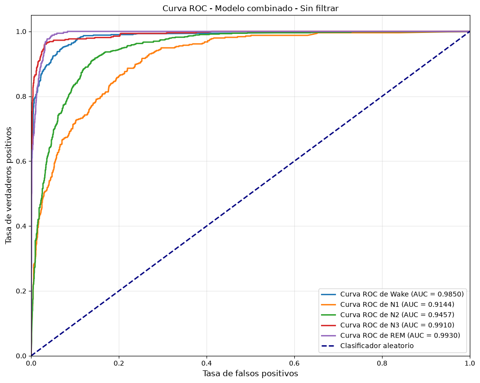
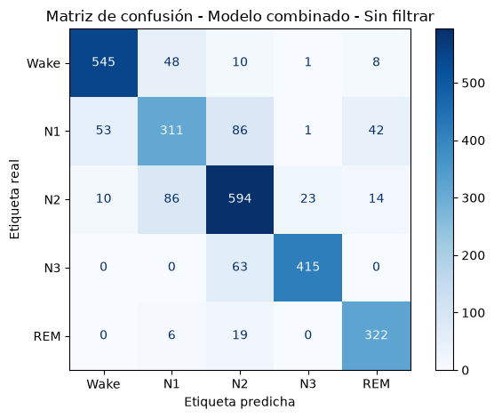
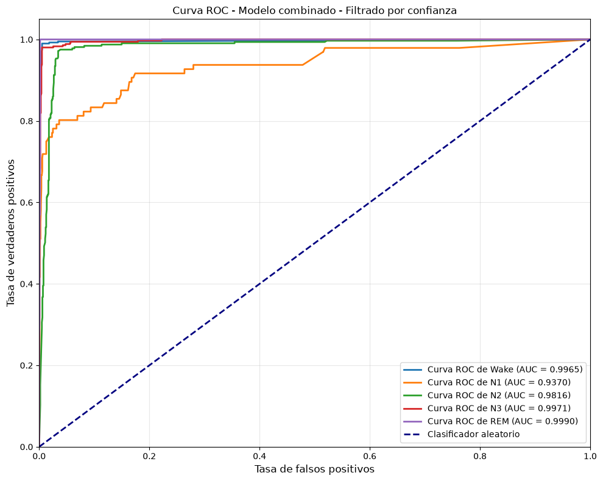
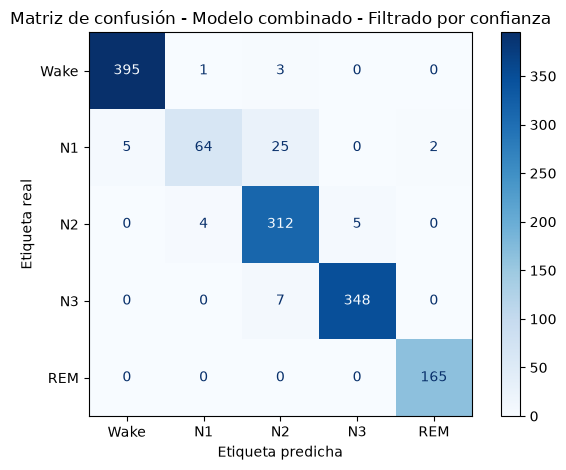

# Clasificación de fases del sueño

> **Resumen**
>
> - **Objetivo:** Clasificar cinco fases del sueño (Wake, N1, N2, N3 y REM) a partir de señales PSG.
> - **Enfoque:** Combinar modelos XGBoost multiclase y binario (para N1/N2), usando extracción de características con YASA.
> - **Datos:** ISRUC-Sleep Cohort III (10 participantes sanos).
> - **Resultado principal:** **96,1 % de exactitud** en las predicciones aceptadas por el filtro (umbral de confianza > 0,95).

Este proyecto entrena una combinación de modelos para clasificar automáticamente las fases del sueño a partir de señales de polisomnografía (PSG). La señal se divide en fragmentos de 30 segundos, llamados épocas, y se extraen características de cada época para entrenar los modelos.

Las anotaciones de dos expertos se utilizan como referencia para entrenar y evaluar el sistema. Dos modelos XGBoost se combinan para predecir cinco clases: Wake, N1, N2, N3 y REM.

Este proyecto es un ejercicio académico de procesamiento de señales y aprendizaje automático. No es un dispositivo médico ni ha sido validado para uso clínico, por lo que sus resultados no deben utilizarse para diagnosticar ni tomar decisiones médicas.

## Resultados

Esta sección presenta el rendimiento del **modelo final**, que combina el clasificador multiclase (Wake, N1/N2, N3, REM) con el clasificador binario (N1 vs N2) para obtener las cinco fases del sueño. Se muestran los resultados del modelo combinado primero sin filtrado de confianza y luego con el filtro activado.

### Sin filtrado de confianza

A continuación se presentan las métricas del modelo combinado sobre todas las épocas de prueba, sin aplicar ningún umbral de confianza.

**Resumen de métricas**

| Épocas | Exactitud | Macro-F1 | AUC |
|----------|-----------|----------|-----|
| 2657 | 0.823 | 0.826 | 0.966 |

**Métricas por clase**

| Clase | Precisión | Recall | F1 | Épocas |
|-------|-----------|--------|----|----------|
| Wake | 0.896 | 0.891 | 0.893 | 612 |
| N1 | 0.690 | 0.631 | 0.659 | 493 |
| N2 | 0.769 | 0.817 | 0.793 | 727 |
| N3 | 0.943 | 0.868 | 0.904 | 478 |
| REM | 0.834 | 0.928 | 0.879 | 347 |
z
**Curva ROC** — muestra la capacidad de discriminación de cada clase frente al resto. El valor AUC de 0.966 indica una buena separación global entre fases.



**Matriz de confusión** — compara las etiquetas reales con las predicciones finales para las cinco fases. Se observa que la confusión principal ocurre entre N1 y N2, las fases de sueño ligero que son más difíciles de distinguir.



### Con filtrado de confianza

El **filtro de confianza** conserva únicamente las predicciones cuya probabilidad máxima supera el umbral `CONFIDENCE_THRESHOLD` (definido en `src/config.py`, valor actual 0.95). De esta forma se descartan las predicciones más inciertas, quedando solo aquellas en las que el modelo está más seguro.

**Resumen de métricas (filtrado)**

| Épocas | Exactitud | Macro-F1 | AUC | Cobertura |
|----------|-----------|----------|-----|-----------|
| 1336 | 0.961 | 0.935 | 0.982 | 50.3 % |

De las 2657 épocas totales, se aceptaron 1336 (50.3 % de cobertura).

**Métricas por clase (filtrado)**

| Clase | Precisión | Recall | F1 | Épocas |
|-------|-----------|--------|----|----------|
| Wake | 0.988 | 0.990 | 0.989 | 399 |
| N1 | 0.928 | 0.667 | 0.776 | 96 |
| N2 | 0.899 | 0.972 | 0.934 | 321 |
| N3 | 0.986 | 0.980 | 0.983 | 355 |
| REM | 0.988 | 1.000 | 0.994 | 165 |

**Curva ROC** — calculada sobre el subconjunto de predicciones aceptadas por el filtro de confianza.



**Matriz de confusión** — construida únicamente con las predicciones cuya confianza supera el umbral.



Al aplicar el filtro de confianza se favorece la **precisión** a costa de perder **recall**. Esto se observa claramente en la clase **N1**, que es la que genera más dudas al modelo: su precisión sube de 0.690 a 0.928, pero su recall cae de 0.631 a 0.667 y el número de ejemplos evaluados se reduce drásticamente (de 493 a 96), ya que muchas épocas de N1 son descartadas por no alcanzar el umbral de confianza.

## Origen de los datos

Los registros proceden de **ISRUC-Sleep**, un conjunto público de polisomnografías de noche completa con señales fisiológicas y anotaciones de fases del sueño realizadas por dos expertos. La página oficial describe tres cohortes:

- Cohorte I: personas con trastornos relacionados con el sueño.
- Cohorte II: ocho personas sanas con dos registros cada una.
- Cohorte III: diez personas sanas.

Para este proyecto se ha escogido el **Cohorte III**, formado por diez personas sanas. Los datos originales no se incluyen en este repositorio: descárgalos desde la [página oficial de ISRUC-Sleep](https://sleeptight.isr.uc.pt/index.html@p=48.html) y consulta sus condiciones de uso antes de utilizarlos o redistribuirlos. En esa página, selecciona la descarga de **ISRUC-Sleep Cohort III**.

El sitio también enlaza la [descripción de columnas y abreviaturas de las anotaciones](http://dataset.isr.uc.pt/ISRUC_Sleep/Content.pdf).

### Preparar los datos localmente

Después de descargar y extraer la Cohorte III, crea una carpeta llamada `data` en la raíz del proyecto, al mismo nivel que `README.md`. Organiza los diez participantes en subcarpetas numeradas del `1` al `10`. El programa espera los siguientes nombres:

```text
data/
├── 1/
│   ├── 1.rec->1.edf
│   ├── 1_1.txt
│   └── 1_2.txt
├── 2/
│   ├── 2.rec->2.edf
│   ├── 2_1.txt
│   └── 2_2.txt
└── ... hasta 10/
```

 Al descargar la Cohorte III, los registros tienen extensión `.rec`. Antes de ejecutar el proyecto, renombra cada archivo `.rec` para que su extensión sea `.edf` y el nombre siga el formato indicado (por ejemplo, `1.rec` a `1.edf`).  Las hojas de cálculo `.xlsx` asociadas a las anotaciones no son necesarias para ejecutar el proyecto.
 En cada carpeta, `<id>.edf` debe ser el registro de polisomnografía del participante y `<id>_1.txt` y `<id>_2.txt` las anotaciones de los dos expertos.

No subas los registros ni las anotaciones originales al repositorio. La disponibilidad pública para investigación no implica necesariamente permiso para volver a publicar los archivos.

## Flujo del proyecto

```text
EDF + anotaciones de dos expertos
                |
                v
Preparar épocas y extraer características
                |
                v
Filtrar artefactos y épocas no concordantes
                |
                v
Separar pacientes: entrenamiento / prueba
                |
                v
Modelo multiclase + modelo binario (separa N1 de N2)
                |
                v
Obtener predicciones -> Wake / N1 / N2 / N3 / REM
                |
                v
Evaluar y generar informe HTML
```

### 1. Preprocesamiento

Las funciones para el preprocesamiento se encuentran en `src/utils.py`

Se procesa cada registro EDF siguiendo estos pasos:

1. Carga la señal y las anotaciones de los dos expertos.
2. Descarta los canales indicados en `src/config.py`.
3. Remuestrea la señal a **100 Hz** y aplica un filtro de **0,3 a 49 Hz**.
4. Divide la señal en segmentos consecutivos de **30 segundos**, llamados **épocas**. Cada época es una muestra del problema de clasificación.
5. Extrae características de cada época con la librería YASA y las relaciona con las etiquetas de los expertos.
6. Detecta posibles **artefactos**: señales o variaciones no deseadas —por ejemplo, movimiento, ruido o mal contacto del electrodo— que distorsionan el registro. Se marca una época si la amplitud pico a pico de algún canal supera `ARTIFACT_THRESHOLD × desviación estándar de la señal`. Este parámetro, definido en `src/config.py`, determina lo estricto del filtro: un valor menor detecta y excluye más épocas; uno mayor, menos. El valor actual es **60**.
7. Elimina las últimas 30 épocas de cada registro, correspondientes al tramo cercano al despertar, cuando la señal puede volverse más inestable. La misma cantidad se elimina de las anotaciones para mantener alineados los datos.

### 2. Preparación y modelos

`src/model_utils.py` separa pacientes por identificador: los pacientes con ID menor o igual que `train_patients` se usan para entrenar y el resto para prueba. El valor actual está en `src/config.py`. Esta separación por paciente evita mezclar épocas del mismo paciente entre ambos conjuntos.

Solo se utilizan las épocas en las que coinciden los dos anotadores. N1 y N2 suelen ser difíciles de distinguir, por lo que se combinan dos modelos: uno multiclase y otro binario.

1. **Multiclase:** cuatro categorías: `Wake`, `N1/N2` (N1 y N2 agrupadas), `N3` y `REM`.
2. **Binario:** distingue `N1` de `N2` dentro del grupo de sueño ligero.

Ambos son clasificadores XGBoost y se someten a una búsqueda de hiperparámetros. El modelo combinado utiliza las probabilidades del clasificador multiclase y, cuando corresponde, las del modelo binario para predecir las cinco fases.

### 3. Confianza e informe

A las predicciones se les aplica un filtro de confianza que conserva aquellas cuya probabilidad máxima supera `CONFIDENCE_THRESHOLD`, definido en `src/config.py`.

`src/report.py` genera `model_report.html` en inglés en la raíz del proyecto al final de la ejecución. Incluye el resumen del experimento, exactitud, macro-F1, AUC, métricas por clase, curvas ROC y matrices de confusión. En la sección filtrada, métricas y gráficas usan las predicciones aceptadas; también se indica la cobertura del filtro.

## Estructura de archivos

```text
Sleep Stages Clasification/
├── README.md                        # Documentación del proyecto
├── requirements.txt                 # Dependencias de Python
├── main_notebook.ipynb              # Ejecución interactiva del flujo
├── model_report.html                # Informe generado al ejecutar el flujo
├── data/                            # Crear localmente; dataset no incluido
│   ├── 1/ ... 10/                   # EDF y anotaciones .txt por participante
└── src/
    ├── config.py                    # Canales, clases y parámetros del flujo
    ├── main.py                      # Ejecución completa del flujo
    ├── model_utils.py               # Preparación, entrenamiento y combinación
    ├── plots.py                     # Funciones genéricas para ROC y matrices
    ├── report.py                    # Generación del informe HTML
    └── utils.py                     # Carga y preprocesamiento de señales
```

## Ejecución

Una vez preparada la carpeta `data/`, ejecuta estos comandos desde la raíz de `Sleep Stages Clasification/`:

```powershell
python -m pip install -r requirements.txt
python src\main.py
```

También se puede ejecutar `main_notebook.ipynb` ejecutando sus celdas en orden. El notebook ofrece una experiencia más interactiva y explica con más detalle cada paso del flujo.

Los principales parámetros se modifican directamente en `src/config.py`. Cambia el valor o la lista correspondiente y vuelve a ejecutar el flujo para aplicar los cambios:

- **`CHANNELS_TO_DROP`**: nombres de los canales que se excluyen del procesamiento. Modifica la lista si quieres conservar o descartar otros canales.
- **`ARTIFACT_THRESHOLD`**: sensibilidad del filtro de artefactos. Un valor menor excluye más épocas y uno mayor excluye menos.
- **`CONFIDENCE_THRESHOLD`**: umbral de confianza entre `0` y `1`. Solo se conservan las predicciones cuya probabilidad máxima supera este valor; aumentarlo hace el filtro más estricto.
- **`train_patients`**: número de pacientes consecutivos, desde el ID 1, que se usan para entrenar. Los pacientes con ID superior se reservan para prueba.
- **`*_CLASS_NAMES` y `*_CLASS_LABELS`**: nombres y etiquetas de las clases para los modelos combinado, multiclase y binario. Mantén sincronizados los nombres y sus etiquetas si los modificas.

El HTML del informe se genera en `model_report.html`, en la raíz del proyecto.

## Dependencias

Las dependencias se instalan desde `requirements.txt`:

- **ipykernel**: permite ejecutar el notebook con un kernel de Python.
- **Matplotlib**: crea las gráficas de evaluación, como las curvas ROC.
- **MNE**: carga y procesa las señales fisiológicas almacenadas en archivos EDF.
- **NumPy**: realiza operaciones numéricas y gestiona matrices y vectores.
- **pandas**: organiza y manipula los datos tabulares.
- **scikit-learn**: proporciona herramientas para dividir los datos, entrenar/evaluar modelos y calcular métricas.
- **Seaborn**: facilita la creación de visualizaciones estadísticas, como las matrices de confusión.
- **XGBoost**: implementa los clasificadores utilizados para predecir las fases del sueño.
- **YASA**: extrae características del sueño a partir de las señales.
