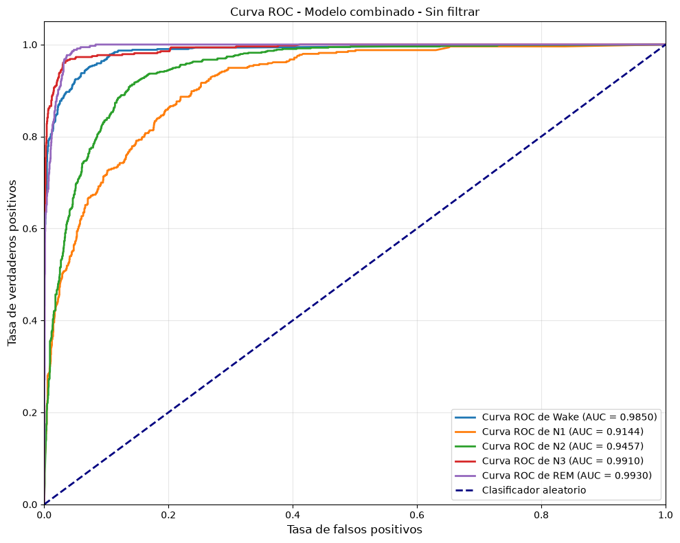
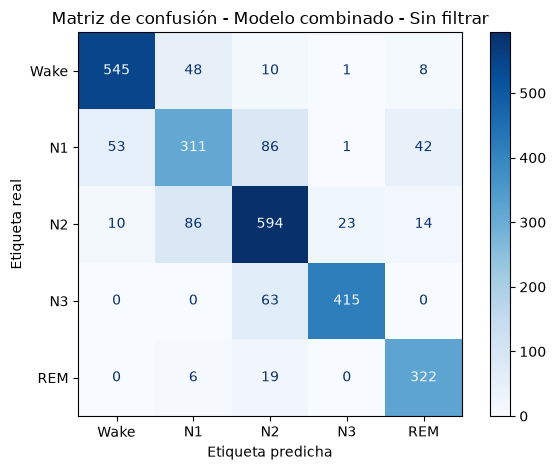
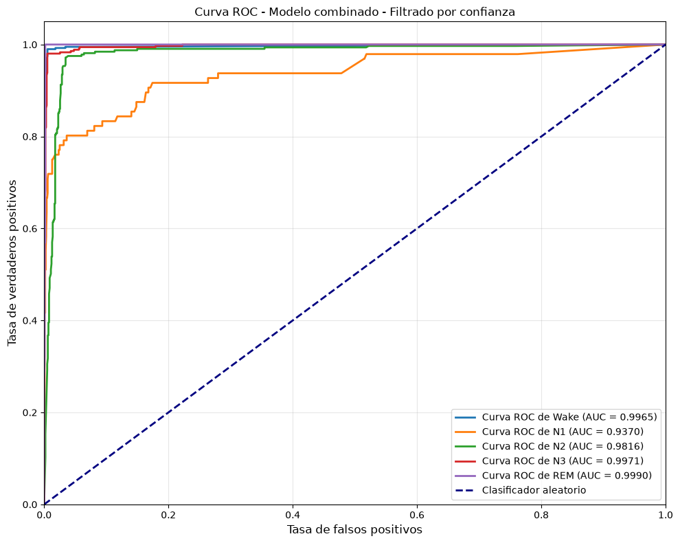
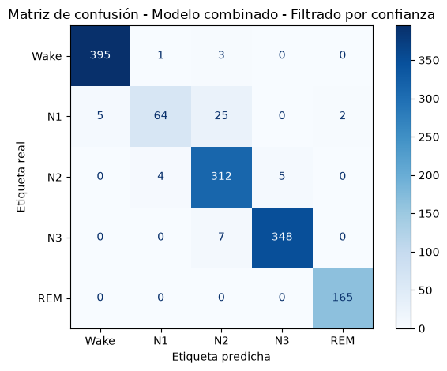

# Sleep Stage Classification

> **Overview**
>
> - **Goal:** Classify five sleep stages (Wake, N1, N2, N3, REM) from PSG signals.
> - **Approach:** Combine XGBoost multiclass and binary models (for N1/N2), using YASA feature extraction.
> - **Dataset:** ISRUC-Sleep Cohort III (10 healthy participants).
> - **Key result:** **96.1% accuracy** on confident predictions (confidence threshold > 0.95).

This project trains a combination of models to automatically classify sleep stages from polysomnography (PSG) signals. The signal is divided into 30-second segments, called epochs, and features are extracted from each epoch to train the models.

Annotations from two experts are used as ground truth for training and evaluating the system. Two XGBoost models are combined to predict five classes: Wake, N1, N2, N3, and REM.

This project is an academic exercise in signal processing and machine learning. It is not a medical device and has not been validated for clinical use. Its results must not be used to diagnose conditions or make medical decisions.

## Results

This section presents the performance of the **final model**, which combines the multiclass classifier (Wake, N1/N2, N3, REM) with the binary classifier (N1 vs. N2) to predict all five sleep stages. Results for the combined model are shown first without confidence filtering and then with the filter enabled.

### Without confidence filtering

The following metrics show the combined model's performance across all test epochs, without applying a confidence threshold.

**Metric summary**

| Epochs | Accuracy | Macro-F1 | AUC |
|---------|----------|----------|-----|
| 2657 | 0.823 | 0.826 | 0.966 |

**Per-class metrics**

| Class | Precision | Recall | F1 | Epochs |
|-------|-----------|--------|----|---------|
| Wake | 0.896 | 0.891 | 0.893 | 612 |
| N1 | 0.690 | 0.631 | 0.659 | 493 |
| N2 | 0.769 | 0.817 | 0.793 | 727 |
| N3 | 0.943 | 0.868 | 0.904 | 478 |
| REM | 0.834 | 0.928 | 0.879 | 347 |

**ROC curve** — shows how well each class is distinguished from the others. The AUC of 0.966 indicates good overall separation between sleep stages.



**Confusion matrix** — compares the true labels with the final predictions for all five sleep stages. The main confusion occurs between N1 and N2, the light-sleep stages that are more difficult to distinguish.



### With confidence filtering

The **confidence filter** keeps only predictions whose maximum probability exceeds the `CONFIDENCE_THRESHOLD` value defined in `src/config.py` (currently 0.95). This removes the most uncertain predictions, leaving only those in which the model has higher confidence.

**Metric summary (filtered)**

| Epochs | Accuracy | Macro-F1 | AUC | Coverage |
|---------|----------|----------|-----|----------|
| 1336 | 0.961 | 0.935 | 0.982 | 50.3% |

Of the 2657 total epochs, 1336 were accepted (50.3% coverage).

**Per-class metrics (filtered)**

| Class | Precision | Recall | F1 | Epochs |
|-------|-----------|--------|----|---------|
| Wake | 0.988 | 0.990 | 0.989 | 399 |
| N1 | 0.928 | 0.667 | 0.776 | 96 |
| N2 | 0.899 | 0.972 | 0.934 | 321 |
| N3 | 0.986 | 0.980 | 0.983 | 355 |
| REM | 0.988 | 1.000 | 0.994 | 165 |

**ROC curve** — calculated using only the predictions accepted by the confidence filter.



**Confusion matrix** — built using only predictions whose confidence exceeds the threshold.



Applying the confidence filter favors **precision** at the cost of **recall**. This is especially clear for **N1**, the class the model finds most uncertain: its precision rises from 0.690 to 0.928, while its recall goes from 0.631 to 0.667 and the number of evaluated examples drops sharply (from 493 to 96), because many N1 epochs do not reach the confidence threshold.

## Data source

The recordings come from **ISRUC-Sleep**, a public full-night polysomnography dataset containing physiological signals and sleep-stage annotations from two experts. The official website describes three cohorts:

- Cohort I: people with sleep-related disorders.
- Cohort II: eight healthy people with two recordings each.
- Cohort III: ten healthy people.

This project uses **Cohort III**, which contains ten healthy people. The original data is not included in this repository. Download it from the [official ISRUC-Sleep website](https://sleeptight.isr.uc.pt/index.html@p=48.html) and review its terms of use before using or redistributing it. On that page, select the **ISRUC-Sleep Cohort III** download.

The website also links to the [description of annotation columns and abbreviations](http://dataset.isr.uc.pt/ISRUC_Sleep/Content.pdf).

### Prepare the data locally

After downloading and extracting Cohort III, create a folder named `data` in the project root, alongside `README.md`. Organize the ten participants into subfolders numbered `1` through `10`. The program expects the following filenames:

```text
data/
├── 1/
│   ├── 1.edf
│   ├── 1_1.txt
│   └── 1_2.txt
├── 2/
│   ├── 2.edf
│   ├── 2_1.txt
│   └── 2_2.txt
└── ... through 10/
```

The downloaded Cohort III recordings have the `.rec` extension. Before running the project, rename each `.rec` file to use the `.edf` extension and the naming format shown above (for example, rename `1.rec` to `1.edf`). The `.xlsx` spreadsheets associated with the annotations are not needed to run the project.

In each folder, `<id>.edf` must be the participant's polysomnography recording, and `<id>_1.txt` and `<id>_2.txt` must contain the annotations from the two experts.

Do not upload the original recordings or annotations to this repository. Public availability for research does not necessarily mean that the files may be republished.

## Project workflow

```text
EDF + annotations from two experts
                |
                v
Prepare epochs and extract features
                |
                v
Filter artifacts and epochs with mismatched annotations
                |
                v
Split patients: training / test
                |
                v
Multiclass model + binary model (distinguishes N1 from N2)
                |
                v
Generate predictions -> Wake / N1 / N2 / N3 / REM
                |
                v
Evaluate and generate an HTML report
```

### 1. Preprocessing

The preprocessing functions are located in `src/utils.py`.

Each EDF recording is processed as follows:

1. Load the signal and annotations from both experts.
2. Drop the channels listed in `src/config.py`.
3. Resample the signal to **100 Hz** and apply a **0.3 to 49 Hz** filter.
4. Divide the signal into consecutive **30-second** segments, called **epochs**. Each epoch is one sample in the classification problem.
5. Extract features from each epoch using the YASA library and associate them with the expert labels.
6. Detect potential **artifacts**: unwanted signals or variations — such as movement, noise, or poor electrode contact — that distort the recording. An epoch is flagged if the peak-to-peak amplitude of any channel exceeds `ARTIFACT_THRESHOLD × signal standard deviation`. This parameter, defined in `src/config.py`, controls how strict the filter is: a lower value detects and excludes more epochs, while a higher value excludes fewer. The current value is **60**.
7. Remove the last 30 epochs from each recording. These correspond to the period near waking, when the signal may become less stable. The same number of epochs is removed from the annotations to keep the data aligned.

### 2. Data preparation and models

`src/model_utils.py` splits patients by ID: patients whose ID is less than or equal to `train_patients` are used for training, and the remaining patients are used for testing. The current value is in `src/config.py`. Splitting by patient prevents epochs from the same patient from appearing in both sets.

Only epochs for which both annotators agree are used. Since N1 and N2 are often difficult to distinguish, the system combines two models: one multiclass model and one binary model.

1. **Multiclass:** four categories: `Wake`, `N1/N2` (N1 and N2 grouped together), `N3`, and `REM`.
2. **Binary:** distinguishes `N1` from `N2` within the light-sleep group.

Both are XGBoost classifiers and undergo hyperparameter search. The combined model uses the probabilities from the multiclass classifier and, when appropriate, those from the binary classifier to predict the five sleep stages.

### 3. Confidence and report

A confidence filter is applied to predictions, keeping those whose maximum probability exceeds `CONFIDENCE_THRESHOLD`, defined in `src/config.py`.

At the end of the run, `src/report.py` generates `model_report.html` in English in the project root. It includes the experiment summary, accuracy, macro-F1, AUC, per-class metrics, ROC curves, and confusion matrices. In the filtered section, metrics and plots use the accepted predictions; the filter coverage is also reported.

## File structure

```text
Sleep Stages Clasification/
├── README.md                        # Project documentation in English
├── README.es.md                     # Project documentation in Spanish
├── requirements.txt                 # Python dependencies
├── main_notebook.ipynb              # Interactive workflow
├── model_report.html                # Report generated by the workflow
├── data/                            # Create locally; dataset not included
│   ├── 1/ ... 10/                   # EDF and .txt annotations per participant
└── src/
    ├── config.py                    # Channels, classes, and workflow parameters
    ├── main.py                      # Runs the complete workflow
    ├── model_utils.py               # Data preparation, training, and combination
    ├── plots.py                     # Generic ROC and confusion-matrix functions
    ├── report.py                    # HTML report generation
    └── utils.py                     # Signal loading and preprocessing
```

## Running the project

After preparing the `data/` folder, run these commands from the `Sleep Stages Clasification/` project root:

```powershell
python -m pip install -r requirements.txt
python src\main.py
```

You can also run `main_notebook.ipynb` by executing its cells in order. The notebook provides a more interactive experience and explains each step of the workflow in more detail.

The main parameters can be changed directly in `src/config.py`. Update the relevant value or list and rerun the workflow to apply the changes:

- **`CHANNELS_TO_DROP`**: names of the channels excluded from processing. Edit the list to keep or drop other channels.
- **`ARTIFACT_THRESHOLD`**: artifact-filter sensitivity. A lower value excludes more epochs; a higher value excludes fewer.
- **`CONFIDENCE_THRESHOLD`**: confidence threshold between `0` and `1`. Only predictions whose maximum probability exceeds this value are kept; increasing it makes the filter stricter.
- **`train_patients`**: number of consecutive patients, starting from ID 1, used for training. Patients with higher IDs are reserved for testing.
- **`*_CLASS_NAMES` and `*_CLASS_LABELS`**: class names and labels for the combined, multiclass, and binary models. Keep names and labels in sync if you change them.

The HTML report is generated as `model_report.html` in the project root.

## Dependencies

Dependencies are installed from `requirements.txt`:

- **ipykernel**: runs the notebook with a Python kernel.
- **Matplotlib**: creates evaluation plots, such as ROC curves.
- **MNE**: loads and processes physiological signals stored in EDF files.
- **NumPy**: performs numerical operations and manages arrays and vectors.
- **pandas**: organizes and manipulates tabular data.
- **scikit-learn**: provides tools for splitting data, training and evaluating models, and calculating metrics.
- **Seaborn**: simplifies statistical visualizations, such as confusion matrices.
- **XGBoost**: implements the classifiers used to predict sleep stages.
- **YASA**: extracts sleep features from the signals.
